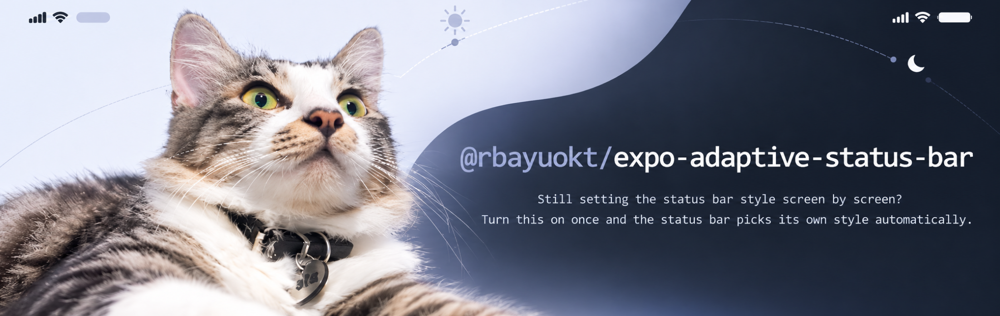
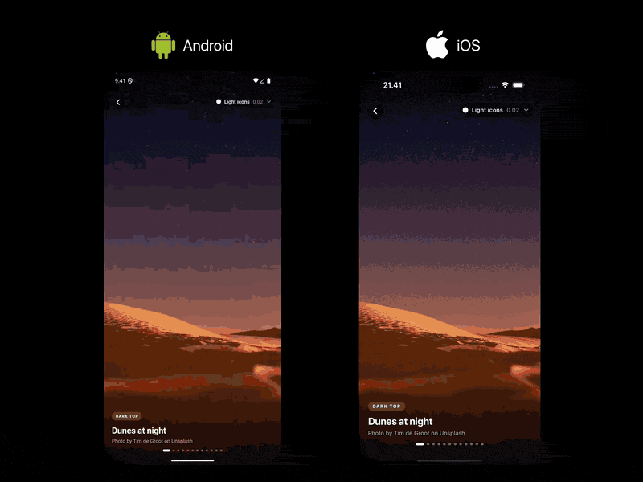
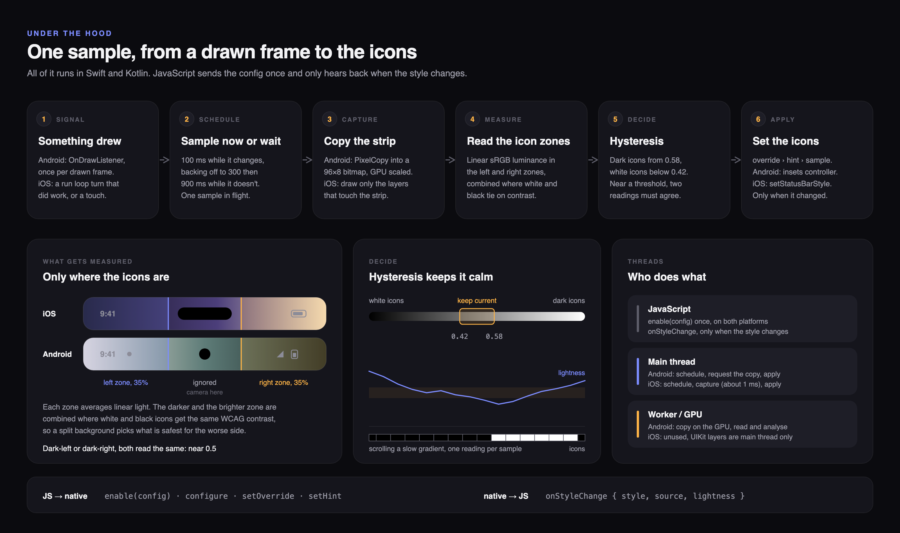
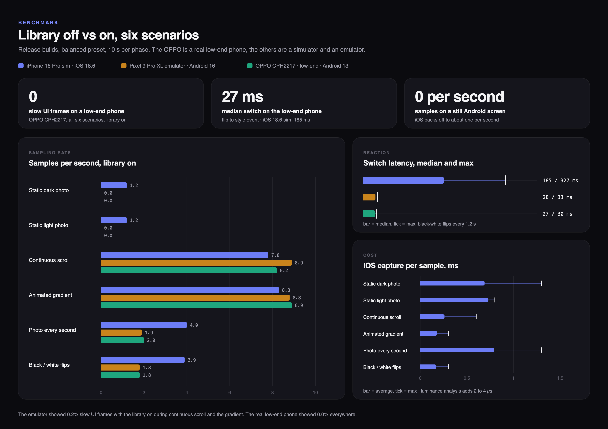
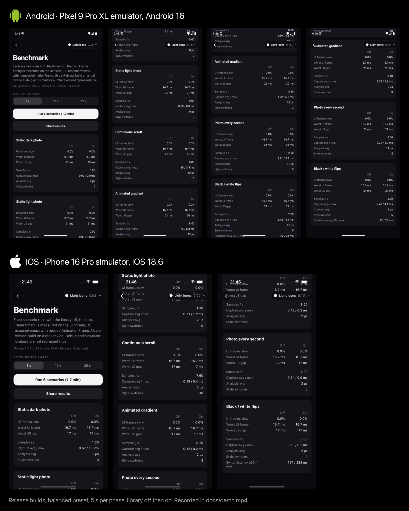

<p align="center">
  
</p>

# @rbayuokt/expo-adaptive-status-bar

<p align="center">
  <a href="docs/demo.mp4"></a>
  <br />
  <sub>Android: Pixel 9 Pro XL emulator, Android 16. iOS: iPhone 16 Pro simulator, iOS 18.6. Release builds, nothing set per screen. The demo plays at about 1.5×, the benchmark at about 4×. <a href="docs/demo.mp4">HD video</a>.</sub>
</p>

**Still setting the status bar style screen by screen? Turn this on once and the status bar
picks its own style automatically.**

## Overview

Everything that runs per frame is native: Swift on iOS, Kotlin on Android. The library looks
at the strip behind the status bar, works out whether it is light or dark, and switches the
icons, all without JavaScript. A night photo gets white icons, a white page gets dark ones,
and a feed that scrolls from one to the other switches as each section passes under the top
edge.

JavaScript calls `enable()` once and only hears back when the style actually changes. Nothing
crosses the bridge per frame and nothing in React re-renders.

```ts
import { AdaptiveStatusBar } from '@rbayuokt/expo-adaptive-status-bar'

AdaptiveStatusBar.enable()
```

That one call covers every screen: photos, scrolling lists, animated backgrounds, navigation
between dark and light screens. No provider, no `<StatusBar style>` per screen.

- **Native capture.** Android copies the strip with `PixelCopy` on the GPU and analyses it on
  a worker thread. iOS draws only the layers that touch the strip into a 96×8 bitmap, about
  1 ms of main thread per sample.
- **Event driven, no polling.** It samples when the app draws (Android) or does UI work (iOS),
  backs off while nothing changes, and does no work at all on a still Android screen.
- **Reads contrast, not average color.** The clock side and the battery side are measured
  separately in linear light, and the style that keeps the worse side readable wins.
  Hysteresis keeps gradients and slow scrolls from flickering.
- **Same decisions on both platforms.** The analysis, hysteresis and scheduling are the same
  code in Swift and Kotlin, checked by the same 24 test cases on each side.
- **Leaves your layout alone.** No insets, no edge-to-edge switch, no window flags. Hints and
  overrides cover screens that need a fixed style.

**At a glance** (Release builds, library off vs on): 0 slow UI frames in all six scenarios on
a low-end Android phone (OPPO CPH2217) and on both iOS simulators, a median switch of 27 ms on
that phone and 185 to 197 ms on iOS, and 0 samples per second on a still Android screen. See
[Performance](#performance).

## Install

The package isn't on npm yet. Once it is, in an Expo project:

```bash
npx expo install @rbayuokt/expo-adaptive-status-bar@latest
npx expo prebuild --clean
npx expo run:ios              # or: npx expo run:android
```

`expo install` also adds the package's config plugin to `plugins` in your app config. The
plugin sets `UIViewControllerBasedStatusBarAppearance` to `NO` in `Info.plist`, which the
iOS side needs: the style is set app-wide, the same way React Native's own `StatusBar`
does it. Expo's template already ships with `NO`, the plugin keeps it that way if
something else turned it on.

This is native code, so the app has to be rebuilt after installing. A development build
from EAS (`eas build --profile development`) works the same as `expo run`. It does not run
in Expo Go; there `enable()` logs a warning and does nothing.

In a React Native app without Expo, add Expo Modules first, then the package, then pods:

```bash
npx install-expo-modules@latest
npm install @rbayuokt/expo-adaptive-status-bar@latest
cd ios && pod install
```

Config plugins only run during `expo prebuild`, so in that setup set
`UIViewControllerBasedStatusBarAppearance` to `NO` in `ios/<App>/Info.plist` yourself (it
is `NO` in the React Native template).

Built and tested against Expo SDK 58 (React Native 0.88, New Architecture). iOS 15.1+,
Android 7.0+ (sampling needs Android 8.0, see [Limits](#limits)).

## Usage

Call `enable()` once, at module level of your root layout or entry file:

```tsx
// app/_layout.tsx
import { AdaptiveStatusBar } from '@rbayuokt/expo-adaptive-status-bar'
import { Stack } from 'expo-router'

AdaptiveStatusBar.enable()

export default function RootLayout() {
  return <Stack screenOptions={{ headerShown: false }} />
}
```

Remove any `<StatusBar style=... />` from `expo-status-bar` or React Native. While the
library is enabled it owns the style, and it puts its own decision back when something
else changes it (counted in `stats.externalWrites`). Use an override instead.

### Overrides and hints

Two ways for a screen to say something. Both are plain hooks, they never re-render
anything, and the most recent one wins until it unmounts.

```tsx
import { useIsFocused } from 'expo-router' // or @react-navigation/native
import { useStatusBarHint, useStatusBarOverride } from '@rbayuokt/expo-adaptive-status-bar'

function PlayerScreen() {
  const focused = useIsFocused()
  // "This screen is dark under the status bar." In hybrid mode sampling pauses while set.
  useStatusBarHint(focused ? 'light' : null)
  return <VideoPlayer />
}

function PhotoEditor() {
  const focused = useIsFocused()
  // "White icons here, no matter what." Wins in every strategy.
  useStatusBarOverride(focused ? 'light' : null)
  return <Editor />
}
```

Pass `null` when the screen is not focused. Stack screens stay mounted underneath the
current one, and a hint from a hidden screen would otherwise still apply. The same works
imperatively with `AdaptiveStatusBar.setOverride('dark')`, `clearOverride()` and
`setHint(style | null)`.

Styles use expo-status-bar's meaning: `'light'` is white icons for dark content, `'dark'`
is dark icons for light content.

### Precedence

```text
override  >  hint (hybrid, manual)  >  sampled  >  fallbackStyle  >  leave the status bar alone
```

| Strategy | Samples pixels | Uses hints | Use it when |
| --- | --- | --- | --- |
| `hybrid` (default) | yes, except while a hint is set | yes | most apps |
| `automatic` | always | no | you never want hints to skip sampling |
| `manual` | never | yes | you only want hints and overrides, with no sampling cost at all |

## Stack

| Area | Choice |
| --- | --- |
| iOS engine | Swift. Culled Core Animation layer walk into a reused 96×8 bitmap, `UIApplication.setStatusBarStyle` |
| Android engine | Kotlin. `PixelCopy` into a reused 96×8 bitmap, analysis on a `HandlerThread`, `WindowInsetsControllerCompat` |
| Shared core | `LuminanceAnalyzer`, `StyleDecider`, `SamplingScheduler`, written once per language, no UI imports |
| Bridge | Expo Modules API: synchronous functions and one `onStyleChange` event |
| JS API | TypeScript, plain functions plus three hooks, no context or provider |
| Config plugin | Sets `UIViewControllerBasedStatusBarAppearance` to `NO` |
| Tests | Jest for the TS layer, XCTest and JUnit for the cores, run on the host without a simulator |
| Example | Expo SDK 58, Expo Router, Reanimated 4, expo-image, expo-video |

The library has no runtime dependencies besides `expo`. The cores never import UIKit, Android
views or Expo, so the controllers also work in a plain UIKit or Android app.

## Configuration

```ts
AdaptiveStatusBar.enable({
  strategy: 'hybrid',
  performance: 'balanced',
  hysteresis: true,
  animation: true,
})

AdaptiveStatusBar.configure({ performance: 'battery' }) // merges into the current config
```

| Option | Default | Does |
| --- | --- | --- |
| `strategy` | `'hybrid'` | See the table above |
| `performance` | `'balanced'` | Preset for the intervals below |
| `samplingInterval` | preset | Fastest interval in ms, used while the strip is changing |
| `maxInterval` | preset | Back-off cap in ms while the app draws but the strip stays the same |
| `quietInterval` | preset | Longest interval in ms after a long stable stretch |
| `idleInterval` | preset | Fallback sample in ms with no activity at all, `0` is off |
| `hysteresis` | `true` | `true` uses 0.42 / 0.58, `false` switches at 0.5, or pass `{ darkThreshold, lightThreshold }` |
| `confirmSamples` | `2` | Readings in a row that must agree before a switch near a threshold |
| `minTransitionInterval` | `250` | Minimum ms between two switches |
| `animation` | `true` | Crossfade the icons on iOS. Android switches instantly either way |
| `fallbackStyle` | none | Style used when nothing else decides |
| `ios.captureMethod` | `'layer'` | `'hierarchy'` uses UIKit's on-screen snapshot, which also sees blur views but costs more |

| Preset | `samplingInterval` | `maxInterval` | `quietInterval` | `idleInterval` |
| --- | --- | --- | --- | --- |
| `battery` | 250 | 1000 | 3000 | 0 |
| `balanced` | 100 | 300 | 900 | 0 |
| `responsive` | 50 | 150 | 300 | 2000 |

Bad values throw a `RangeError` from `enable()` or `configure()` before anything reaches
native (thresholds outside 0..1, `darkThreshold` above `lightThreshold`, `maxInterval`
below `samplingInterval`, and so on). Native validates again.

## How it works

<p align="center">
  
</p>

One sample goes: something draws → the scheduler decides to sample now or wait → the
strip behind the status bar is copied into a 96×8 bitmap → the left and right icon zones
are measured → hysteresis decides → the style is set if it changed. Everything in that
chain is Swift or Kotlin. JavaScript calls `enable(config)` once and gets an
`onStyleChange` event only when the applied style changes.

### When it samples

Nothing polls. Each platform has a cheap signal that the screen might have changed:

- **Android:** a `ViewTreeObserver.OnDrawListener` on the window. It fires when the app
  draws a frame and never when it doesn't, so a static screen costs nothing.
- **iOS:** a run loop observer that fires once per main run loop turn that did work, plus a
  passive gesture recognizer on the key window that never recognizes, delays or cancels
  anything. iOS has no draw callback, and a React Native app's main run loop rarely sleeps
  for long (about 70 turns per second on a still screen in the simulator), so the interval
  backs off while readings stay the same and a touch resets it.

The scheduler (`SamplingScheduler`, same logic in Kotlin and Swift) answers each signal
with a delay or with "stay idle". It never runs two samples at once, always takes a
trailing sample after the last activity so the final frame is measured, doubles the
interval while the reading stays the same (up to `maxInterval`, then `quietInterval` after
four stable samples at the cap), and drops back to `samplingInterval` as soon as the
reading changes or, on iOS, the screen is touched.

### How it reads pixels

- **Android:** `PixelCopy.request(window, rect, bitmap, ...)` copies just the strip into a
  reused 96×8 bitmap, scaled by the GPU. The main thread only issues the request. The
  callback runs on a worker thread, which reads the 768 pixels and does the math, then
  posts the result back. One listener and one result slot are reused for every sample,
  and a stale result (after a pause or config change) is dropped by a generation check.
  The system's status bar icons live in SystemUI's window, so they are never in the copy.
- **iOS:** there is no screen copy API, so the app's own layers are drawn into a reused
  96×8 bitmap on the main thread. Drawing the whole window with `CALayer.render(in:)` cost
  7 to 12 ms on the simulator, because it draws every offscreen page and every screen stacked under the
  current one. `StripRenderer` walks the layer tree instead and only draws what touches the
  strip: plain container layers (including UIKit's window and wrapper subclasses) get their
  background filled directly, an image with children is drawn from its `CGImage` with the
  layer's gravity, true leaves (images, text, gradients) go through `render(in:)`, and
  anything behind an opaque layer that covers the strip is skipped. That brought a sample
  to about 1 ms in a Release build on the simulator.

The iOS sampler never modifies a layer. Any Core Animation change starts a transaction,
the transaction wakes the run loop, the observer counts that as app activity, and the
sampler would keep scheduling itself. An earlier version did exactly that: 180 run loop
wake-ups per second with the library on against 70 with it off, on the simulator.

### How it decides

Each icon zone (the left and right 35% of the strip, where the clock and the battery sit)
averages linearised sRGB relative luminance. The middle is ignored, it is usually empty or
the camera cutout. The darkest and brightest zone are combined at the point where white
and black icons have the same WCAG contrast ratio, `sqrt((dark + 0.05) × (bright + 0.05)) −
0.05`, so a split background picks the style that is safest for the worse side. The
result is converted to CIE L* scaled to 0..1, where 0.5 is perceptual mid grey.

`StyleDecider` then switches to dark icons from 0.58 and to white icons below 0.42.
Anything in between keeps the current style. A reading near a threshold must repeat
(`confirmSamples`), a reading far past one (0.12 or more) switches at once, and two
switches are at least `minTransitionInterval` apart. A pending switch keeps the scheduler
sampling, so it is never left waiting on an idle screen.

### Threads and lifecycle

| | Android | iOS |
| --- | --- | --- |
| Activity signal | main, a few comparisons per frame | main, a few comparisons per run loop turn |
| Capture | GPU, then a worker thread | main, about 1 ms |
| Analysis | worker, 768 pixels | main, 2 to 4 µs |
| Apply style | main, only on change | main, only on change |
| `getStats()` | JS thread, plain field reads | JS thread, locked copy |
| Suspends on | activity in background | app in background |

`getStats()` never posts to the main thread; on iOS that alone would wake the run loop and
count as activity. Pausing or disabling drops any pending sample, forgets the last reading
and removes the listeners. `disable()` also releases the bitmap.

## Limits

What can be sampled depends on what the app draws itself.

| Content | Android | iOS |
| --- | --- | --- |
| Views, images, text, gradients, React Native and Reanimated animations | sampled | sampled |
| ScrollView, FlatList, native stack transitions | sampled | sampled |
| Video in a `TextureView` (`expo-video` `surfaceType="textureView"`) | sampled | n/a |
| Video in a `SurfaceView` (the `expo-video` Android default) | not sampled, separate surface | n/a |
| Video, camera previews (`AVPlayerLayer`, `AVCaptureVideoPreviewLayer`) | n/a | not sampled |
| Metal and OpenGL content, e.g. Skia | sampled in a `TextureView`, not in a `SurfaceView` | not sampled |
| Blur views (`UIVisualEffectView`, `expo-blur`) | sampled | not reliable with `'layer'`, try `'hierarchy'` (untested) |
| React Native `<Modal>` | not sampled, it is its own window | sampled |

For content that can't be sampled, declare it with `useStatusBarHint` or
`useStatusBarOverride`.

Other things worth knowing:

- **It doesn't change your layout.** No edge-to-edge switch, no insets, no window flags:
  it reads whatever is behind the status bar. Expo SDK 54+ apps are edge-to-edge on
  Android by default, and Android 15+ enforces it for apps targeting it. If an Android app
  isn't edge-to-edge, the strip behind the status bar is the window's status bar color,
  which `PixelCopy` copies like anything else. On iOS content always sits under the status
  bar, your safe area padding decides what shows there.
- **iOS 17 and later can adapt on their own.** With the style left at `.default`, UIKit
  [keeps the icons readable](https://developer.apple.com/documentation/uikit/uistatusbarstyle/default)
  over the content below. This library sets an explicit light or dark style instead, so the
  same thresholds, hints, overrides, readings and events apply on iOS 15 and up and on
  Android. If you only ship iOS 17+ and need none of that, leaving the style at `.default`
  (and not using a status bar library at all) is the cheaper option.
- **iOS needs `UIViewControllerBasedStatusBarAppearance = NO`.** With `YES` the system
  asks view controllers for the style, which a module can't take over without swizzling.
  `stats.supported` is then `false` and nothing changes. The config plugin sets `NO`.
- **Android 7.x** has no `PixelCopy` for windows. Sampling is off, and only hints,
  overrides and `fallbackStyle` apply.
- **Hidden status bar** (including landscape on iPhone): ticks are skipped, and showing it
  again draws a frame, which wakes sampling up.
- **iOS samples the active scene's key window.** Windows above it, like other libraries'
  overlay windows, aren't included.
- **Android** suspends with the activity, **iOS** with the app. Both drop pending work and
  forget the last reading, so the first sample after resuming decides on its own.
- **iOS changes without a touch** (navigation from code, a timer-driven carousel) are seen
  on the next sample. After a long stable stretch that can be up to `quietInterval` away.
  Touches reset the interval at once.
- **Android runs `PixelCopy` on the render thread.** On the emulator that cost about 1 slow
  frame in 10 seconds of continuous motion. On a low-end phone (OPPO CPH2217) it cost none.

## Performance

Measured with the example's benchmark screen, Release builds, `balanced`, 10 seconds per
phase with the library off and then on. The OPPO CPH2217 is a real **low-end** Android phone.
The rest are simulators and an emulator, so read their numbers as relative.

<p align="center">
  
</p>

The chart is generated from the numbers below by `npm run docs:graphics`. It shows one of the
two iOS simulator runs, they are nearly identical.

### How to read these numbers

The question the benchmark answers is simple: **does turning the library on make the app
any worse?** Each scenario puts something on screen and runs twice for 10 seconds, first
with the library off, then on. The app is measured the same way both times, so any
difference between the two columns is the library's cost.

The six scenarios each push on a different part of it:

| Scenario | What is on screen | What it tests |
| --- | --- | --- |
| Static dark photo, static light photo | one photo, nothing moves | does it go quiet when nothing changes |
| Continuous scroll | colored bands scrolling at 1,200 pt/s, driven on the UI thread | the worst case: content under the status bar changes every frame |
| Animated gradient | the background fades dark to light and back every 1.5 s | does it flicker while the content hovers around the middle |
| Photo every second | a new photo each second | the common case of content changing now and then |
| Black / white flips | the screen turns black or white every 1.2 s | how fast the icons follow a change |

What each number means, and what good looks like:

- **Slow UI frames** is the share of frames that took noticeably longer than usual to
  draw, which users feel as stutter. Compare **off** with **on**. If they match, the
  library didn't make anything stutter. This is the most important row.
- **Worst UI frame** is the single slowest frame. 16.7 ms is one frame on a 60 Hz screen,
  so 16.7 in both columns means not even one frame ran late.
- **Worst JS gap** is the longest the JavaScript thread went without a frame. The library
  never runs JavaScript while it works, so this should be the same in both columns.
- **Samples / s** is how often it looked under the status bar. High while content moves
  (it has to look to keep up), low or zero when the screen is still. A still screen with a
  high number would mean wasted battery.
- **Capture avg / max** is how long one look takes. On iOS that time comes out of the main
  thread, so smaller is better and anything far below one frame (16.7 ms) is safe. On
  Android it is the copy's round trip on the GPU and a worker thread, so it doesn't block
  anything.
- **Style switches** is how often the icons actually changed color. It should match what
  you'd expect from the content: the gradient changes direction about 7 times in 10
  seconds, so 7 switches means no flicker. 20 or 30 there would mean flicker.
- **Switch latency** is the time from the background changing to the app being told the
  icons switched. Under about 200 ms reads as instant to most people.

In the chart, each color is one device (see the legend). The three tiles at the top are
the headline results. The left panel shows how often each device sampled in each
scenario: longer bars mean more work, and the empty rows on a still screen are the point.
On the right, a bar is the typical value (median or average) and the white tick is the
worst one, so a short bar with a far tick means usually fast with an occasional slow one.

Simulators and emulators run on the Mac's CPU and GPU, so their absolute numbers don't
transfer to phones. The comparison between **off** and **on** does.

**iOS, iPhone 15 Pro simulator, iOS 26.1**

| Scenario | Slow UI frames, off / on | Samples/s | Capture avg / max |
| --- | --- | --- | --- |
| Static dark photo | 0.0% / 0.0% | 1.2 | 0.61 / 1.1 ms |
| Static light photo | 0.0% / 0.0% | 1.2 | 0.91 / 1.4 ms |
| Continuous scroll | 0.0% / 0.0% | 8.0 | 0.28 / 0.6 ms |
| Animated gradient | 0.0% / 0.0% | 8.3 | 0.18 / 0.4 ms |
| Photo every second | 0.2% / 0.0% | 4.0 | 0.87 / 1.4 ms |
| Black / white flips | 0.0% / 0.0% | 3.9 | 0.22 / 0.4 ms |

Switch latency on the flips (style change event received in JS after the background
changed): p50 196 ms, max 324 ms.

**iOS, iPhone 16 Pro simulator, iOS 18.6**

| Scenario | Slow UI frames, off / on | Samples/s | Capture avg / max |
| --- | --- | --- | --- |
| Static dark photo | 0.0% / 0.0% | 1.2 | 0.69 / 1.3 ms |
| Static light photo | 0.0% / 0.0% | 1.2 | 0.73 / 0.8 ms |
| Continuous scroll | 0.0% / 0.0% | 7.8 | 0.26 / 0.6 ms |
| Animated gradient | 0.0% / 0.0% | 8.3 | 0.18 / 0.3 ms |
| Photo every second | 0.0% / 0.0% | 4.0 | 0.79 / 1.3 ms |
| Black / white flips | 0.0% / 0.0% | 3.9 | 0.17 / 0.3 ms |

Switch latency on the flips: p50 185 ms, max 327 ms. On both iOS runs luminance analysis
took 2 to 4 µs, and all of a sample's cost is main thread time.

**Android, OPPO CPH2217, low-end device, Android 13**

| Scenario | Slow UI frames, off / on | Worst UI frame, off / on | Samples/s | Copy round trip avg / max |
| --- | --- | --- | --- | --- |
| Static dark photo | 0.0% / 0.0% | 18.3 / 16.7 ms | 0.00 | - |
| Static light photo | 0.0% / 0.0% | 17.9 / 17.0 ms | 0.00 | - |
| Continuous scroll | 0.0% / 0.0% | 16.6 / 16.6 ms | 8.2 | 10.9 / 17.6 ms |
| Animated gradient | 0.0% / 0.0% | 16.7 / 16.7 ms | 8.9 | 5.2 / 14.2 ms |
| Photo every second | 0.0% / 0.0% | 17.6 / 17.3 ms | 2.0 | 5.6 / 10.4 ms |
| Black / white flips | 0.0% / 0.0% | 17.5 / 17.0 ms | 1.8 | 5.3 / 9.0 ms |

Switch latency on the flips: p50 27 ms, max 30 ms. Luminance analysis took 79 to 402 µs on the
worker thread. The worst frame was 18.3 ms, under 2 ms past one 60 Hz frame, and it came
from a library-off phase.

**Android, Pixel 9 Pro XL emulator, Android 16**

| Scenario | Slow UI frames, off / on | Worst UI frame, off / on | Samples/s | Copy round trip avg |
| --- | --- | --- | --- | --- |
| Static dark photo | 0.0% / 0.0% | 16.7 / 16.7 ms | 0.00 | - |
| Static light photo | 0.0% / 0.0% | 16.7 / 16.7 ms | 0.00 | - |
| Continuous scroll | 0.0% / 0.2% | 16.7 / 33.3 ms | 8.9 | 9.7 ms |
| Animated gradient | 0.0% / 0.2% | 16.7 / 50.0 ms | 8.8 | 3.4 ms |
| Photo every second | 0.0% / 0.0% | 16.7 / 16.7 ms | 1.9 | 5.8 ms |
| Black / white flips | 0.0% / 0.0% | 16.7 / 16.7 ms | 1.8 | 6.0 ms |

Switch latency on the flips: p50 28 ms, max 33 ms. The copy round trip runs off the main
thread; it is mostly the emulator's software GPU.

A static Android screen does no work at all. A static iOS screen still sees run loop
activity from UIKit and React Native, so it backs off to `quietInterval` instead of zero.

What stays flat by construction: one reused bitmap and buffer per platform, a reused copy
listener on Android (the window insets lookup is the only per-sample allocation), nothing
sent over the bridge per sample, JavaScript never runs during monitoring, and style change
events only fire when the style actually changes.

### The recorded run

[docs/demo.mp4](docs/demo.mp4) records both devices through the demo and a full benchmark
at 5 seconds per phase. The video is cut to one minute: the demo plays at about 1.5× and
the benchmark at about 4×, timed so both phones change sections together. The numbers are
from the real-time run. Its results screens, top to bottom:

<p align="center">
  
</p>

In that run neither device had a slow UI frame in any scenario, with the library off or
on. Switch latency was 22 / 24 ms (median / max) on Android and 197 / 282 ms on iOS, and a
still screen took 0 samples per second on Android and 1.2 on iOS.

The benchmark screen also starts from a link, which is how the recording runs it:
`adaptivestatusbar://benchmark?autorun=5` (5, 10 or 20 seconds per phase).

### Running it on a phone

```bash
npm run prepare
cd example
npm run ios:device:release       # or android:device:release
```

Open **Benchmark** on the home screen and run it. **Share results** exports the numbers as
text with the device and build type. Run it with the phone unplugged when you care about
energy, and use Xcode's Energy gauge or `adb shell dumpsys batterystats` alongside for
power.

## Diagnostics

```ts
const stats = AdaptiveStatusBar.getStats() // synchronous, never touches the UI thread
AdaptiveStatusBar.resetStats()
const sub = AdaptiveStatusBar.addListener(({ style, source, lightness }) => {})
```

`getStats()` returns the current style and its source, the interval, sample, skip and
failure counts, capture, analysis and main thread times (average and max), activity signal
count, external writes, and the last left, right and combined lightness. The
`useAdaptiveStatusBarStats(intervalMs)` hook polls it and only re-renders when a value
changed.

On iOS `captureMs*` is the main thread render; on Android it is the asynchronous copy round
trip. `mainThreadMs*` is the number to compare across platforms.

## Troubleshooting

- **`Native module not found` warning, nothing changes.** The app wasn't rebuilt after
  installing, or it's running in Expo Go. Run `npx expo prebuild --clean` and
  `npx expo run:ios` / `run:android`. On iOS, native modules are resolved when
  `pod install` runs, so after upgrading, renaming or moving the package run
  `cd ios && pod install` again. Android resolves them on every Gradle build.
- **iOS icons never change, `getStats().supported` is `false`.**
  `UIViewControllerBasedStatusBarAppearance` is `YES` in `Info.plist`. Add the config plugin
  and prebuild, or set it to `NO` yourself in a project without prebuild.
- **The style flips back right after something else sets it.** Another component is setting
  the style, e.g. a `<StatusBar style=... />`. `getStats().externalWrites` counts these.
  Remove it and use `useStatusBarOverride` where a screen needs a fixed style.
- **Wrong style over video, camera or Skia content.** Those can't be sampled (see
  [Limits](#limits)). Declare the screen with `useStatusBarHint`.

## Example app

```bash
npm install
npm run example:ios          # or example:android
```

Seven demos plus the benchmark, all edge to edge with no status bar style set anywhere:
a photo gallery, an editorial feed that scrolls through photos, paper and color blocks, a
2,000 row FlatList, a Reanimated day and night loop with three speeds, edge cases (split,
stripes, mid grey, pure blue and yellow, a bright center under the camera), Expo Router
navigation with a rapid push test and optional screen hints, and video with the Android
`SurfaceView` / `TextureView` switch. The pill in the top right shows the live reading and
opens a panel with strategy, preset, hysteresis and iOS capture controls.

Photos are from Unsplash, credited on each slide.

## Scripts

| Command | Does |
| --- | --- |
| `npm run prepare` | Clean build of `src/` into `build/`, which the example consumes |
| `npm run build` | `tsc`, in watch mode when run in a terminal |
| `npm run typecheck` | Type check without emitting |
| `npm run lint` | ESLint on `src/` |
| `npm run test:unit` | Jest: config validation and override stack |
| `npm run test:ios` | Swift core tests with plain `xctest`, no simulator |
| `npm run test:android` | Kotlin core tests on the JVM, no emulator or prebuild |
| `npm run test:full` | All of the above |
| `npm run example:ios` / `example:android` | Install and run the example |
| `npm run open:ios` / `open:android` | Open the example in Xcode or Android Studio |
| `npm run docs:graphics` | Regenerate `docs/how-it-works` and `docs/benchmark` (SVG, then PNG via headless Chrome) |

## Layout

```text
src/                     TypeScript API, config validation, hooks
ios/
  Core/                  LuminanceAnalyzer, StyleDecider, SamplingScheduler (Foundation only)
  StripRenderer.swift    culled layer tree drawing
  StatusBarSampler.swift scene, window, bitmap, capture
  AdaptiveStatusBarController.swift  signals, lifecycle, style
  AdaptiveStatusBarModule.swift      Expo bridge
android/src/main/java/expo/modules/adaptivestatusbar/
  core/                  the same three classes, plain Kotlin
  AdaptiveStatusBarController.kt     draw listener, PixelCopy, lifecycle, style
  AdaptiveStatusBarModule.kt         Expo bridge
app.plugin.js            sets UIViewControllerBasedStatusBarAppearance = NO
example/                 Expo Router app with the demos and the benchmark
```

The shape in one line: `Core/` and `core/` import nothing from the platform UI or Expo and
are tested on the host, the controllers import nothing from Expo, so they work in a plain
UIKit or Android app (`enable(config)`, plus `attach(activity)` on Android), and only the
two `*Module` files know about JavaScript.

The Swift and Kotlin cores implement the same decisions and share their test cases
(`ios/Tests/CoreTests.swift` and `android/src/test/.../CoreTest.kt`, 24 each).

---

Created by [@rbayuokt](https://github.com/rbayuokt), made with ❤️ and 🎵
